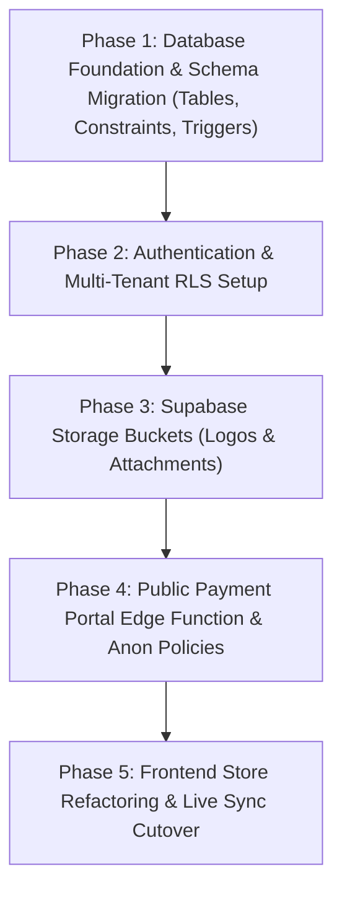

# Backend Blueprint: Supabase Architecture & Implementation Specification

> **Document Status**: Complete Architecture & Implementation Blueprint  
> **Target Platform**: Supabase (PostgreSQL 15+, Supabase Auth, Storage, Edge Functions, Row-Level Security)  
> **Source Base**: React 18 / TypeScript SPA (`src/`)  
> **File Scope**: Strictly grounded in existing frontend implementation with explicit source code citations.

---

## 1. Feature Inventory

The following inventory maps every user-facing capability implemented in the React application, its source location, and its current execution status:

| # | Feature / Sub-Feature | Component / File Citation | Execution Status | Notes & Evidence |
|---|---|---|---|---|
| **1** | **User Authentication & Session** | `src/features/auth/AuthPage.tsx`, `src/store/authStore.ts`, `src/components/auth/ProtectedRoute.tsx` | **Mocked** | Login/Register updates Zustand `authStore` (`egolepay-auth`) with dummy UUID and user state. No remote Supabase Auth network call; passwords are not verified or transmitted. |
| **2** | **Invoice Listing & Filtering** | `src/features/invoices/InvoicesPage.tsx`, `src/features/invoices/InvoiceTable.tsx`, `src/store/invoiceStore.ts` | **Working (Local)** | In-memory & LocalStorage filtering by tab status (`all`, `draft`, `sent`, `paid`, `overdue`), search query across number, client name, item description. |
| **3** | **Invoice Creation & Editing** | `src/features/invoices/InvoiceEditorPage.tsx`, `src/features/invoices/InvoiceForm.tsx`, `src/features/invoices/invoiceSchema.ts` | **Working (Local)** | Form handled via `react-hook-form` + `zod`. Generates client-side IDs (`inv-...`), saves to `invoiceStore` (`egolepay-invoices`). |
| **4** | **Line Item Dynamic Management** | `src/features/invoices/InvoiceForm.tsx` (`useFieldArray`), `src/types/saas.ts` (`LineItem`) | **Working (Local)** | Dynamic append, remove, recompute on line item quantity and unit price changes. |
| **5** | **Catalog Product Insertion** | `src/features/inventory/CatalogPickerModal.tsx`, `src/features/invoices/InvoiceForm.tsx` | **Working (Local)** | Selects inventory item from `productStore` and autofills description, unit price, and product ID. |
| **6** | **Invoice Duplication** | `src/store/invoiceStore.ts` (`duplicateInvoice`), `src/features/invoices/InvoiceTable.tsx` | **Working (Local)** | Clones source invoice with new ID, sequential number, reset to `draft`, and today's issue date. |
| **7** | **Invoice Status Lifecycle** | `src/store/invoiceStore.ts` (`updateStatus`), `src/features/invoices/InvoiceTable.tsx` | **Working (Local)** | Supports `draft`, `sent`, `paid`, `partially_paid`, `overdue`, `cancelled`. Computes outstanding balances upon status changes. |
| **8** | **Payment Recording & History** | `src/features/invoices/RecordPaymentModal.tsx`, `src/features/invoices/PaymentReceiptModal.tsx`, `src/store/invoiceStore.ts` (`addPaymentRecord`) | **Working (Local)** | Records partial/full payments, assigns receipt numbers (`REC-XXXXXX`), calculates remaining balance, auto-transitions status to `partially_paid` or `paid`. |
| **9** | **Public Payment Portal** | `src/features/public/PublicInvoicePayPage.tsx` (`/pay/:id`) | **Working (Local / Mocked Payment)** | Unauthenticated public view for clients. Lookups via ID or `publicPaymentToken`. Processes simulated credit card or bank transfer deposits via `setTimeout(..., 1200)`. |
| **10** | **PDF Generation & Export** | `src/features/invoices/InvoicePDF.tsx`, `src/features/invoices/InvoicePDFDownloadButton.tsx`, `src/lib/exportUtils.ts` | **Working (Client)** | Uses `@react-pdf/renderer` in browser to render and download branded PDFs (`Classic`, `Modern`, `Minimal`). |
| **11** | **CSV / JSON Data Export & Backup** | `src/features/invoices/ExportInvoicesModal.tsx`, `src/lib/exportUtils.ts`, `src/lib/backupService.ts` | **Working (Client)** | Generates CSV streams of invoices and clients; serializes full workspace JSON snapshot for backup/restore. |
| **12** | **Customer / Client CRM** | `src/features/clients/ClientsPage.tsx`, `src/features/clients/ClientModal.tsx`, `src/store/customerStore.ts` | **Working (Local)** | Full CRUD for customers stored in `egolepay-customers` with invoice association counts. |
| **13** | **Inventory & Stock Tracking** | `src/features/inventory/InventoryPage.tsx`, `src/features/inventory/ProductModal.tsx`, `src/store/productStore.ts` | **Working (Local)** | Tracks products vs. services, unit pricing, stock levels, low-stock alerts, and auto-stock deduction upon invoice issuance (`deductStockForInvoice`). |
| **14** | **Recurring Invoices & Retainers** | `src/features/invoices/CreateRecurringModal.tsx`, `src/features/invoices/RecurringSchedulesList.tsx`, `src/store/recurringStore.ts` | **Working (Local)** | Schedules recurring cycles (`weekly`, `biweekly`, `monthly`, `quarterly`, `annually`), manually triggers new cycle invoices, computes next run dates. |
| **15** | **Business Profile & Settings** | `src/features/settings/SettingsPage.tsx`, `src/store/businessStore.ts`, `src/store/settingsStore.ts` | **Working (Local)** | Company details, tax IDs, banking information, default currency, prefix, accent color, and base64 logo storage. |
| **16** | **Multi-Business Switching** | `src/store/businessStore.ts`, `src/components/layout/Navbar.tsx` | **Working (Local)** | Allows switching between multiple business profiles (`biz-default-01`, `biz-demo-02`) on the Business plan tier. |
| **17** | **Subscription & Quota Management** | `src/features/subscription/SubscriptionPage.tsx`, `src/store/subscriptionStore.ts`, `src/components/saas/PlanUpgradeModal.tsx` | **Mocked / Partial** | Gates features (`multi_currency`, `custom_accent`, `payment_portal`, templates, invoice limits: 5 for Free, 50 for Starter, Unlimited for Business). Upgrading simply flips local state without payment processor integration. |
| **18** | **Cloud Synchronization Bridge** | `src/services/supabase/client.ts`, `src/services/supabase/syncService.ts`, `src/services/api/cloudSyncManager.ts` | **Partial** | Initial Supabase client stub exists; one-click local-to-cloud snapshot sync button exists in Settings, but no continuous real-time two-way synchronization. |

### Incomplete in Frontend
- **Real Payment Gateway Integration**: In `src/features/public/PublicInvoicePayPage.tsx` (lines 102–139), card processing is simulated via `setTimeout` and hardcoded test cards (`4242...`). No Stripe, Paystack, or Flutterwave webhook or API integration exists.
- **Automated Recurring Billing Cron**: In `src/store/recurringStore.ts` (`checkAndRunDueSchedules`), recurring cycles must be triggered manually or upon browser tab open (`initSync.ts`). There is no background worker executing unattended billing runs.
- **Transactional Stock Decrement**: Stock is decremented in `src/store/productStore.ts` (`deductStockForInvoice`) via client JavaScript. If an invoice edit removes items or cancels the invoice, stock is not automatically rolled back.
- **Email Delivery of Invoices**: The "Mark as Sent" button updates status in `src/store/invoiceStore.ts` (`updateStatus`), but no SMTP, Resend, or SendGrid email dispatch exists.
- **Logo Storage via CDN**: Logos are stored as massive base64 Data URIs directly within `BusinessProfile` objects in localStorage (`SAMPLE_LOGO_DATA_URI` in `src/store/sampleData.ts` and `handleLogoUpload` in `src/features/settings/SettingsPage.tsx`).

---

## 2. Data Entities and Fields

The frontend models its domain across `src/types/saas.ts`, `src/types/index.ts`, and Zod schemas in `src/features/invoices/invoiceSchema.ts`.

### 2.1 Entity: `BusinessProfile` (Organization / Tenant)
- **Source**: `src/types/saas.ts` (`BusinessProfile`, `BusinessDetails`), `src/store/businessStore.ts`
- **Fields**:
  - `id` (string, required): Unique identifier (e.g., `biz-default-01`).
  - `name` (string, required): Company business name (`z.string().min(1)`).
  - `email` (string, required): Official contact email.
  - `phone` (string, required): Contact phone number.
  - `address` (string, required): Multi-line street address.
  - `website` (string, optional): Company URL.
  - `taxId` (string, optional): Tax Identification Number (e.g., `TIN-98765432-0001`).
  - `bankDetails` (string, optional): Bank name, account number, sort code for invoice footer.
  - `logo` (string, optional): Base64 data URL (max 2MB validated in `SettingsPage.tsx`).
  - `defaultCurrency` (string, required): Default currency code (e.g., `NGN`, `USD`). Default: `'NGN'`.
  - `defaultTaxRate` (number, required): Default tax percentage. Default: `7.5`.
  - `defaultPaymentTermsDays` (number, required): Payment window in days. Default: `14`.
  - `invoicePrefix` (string, required): Sequential prefix. Default: `'INV-'`.
  - `accentColor` (string, required): Hex color code. Default: `'#FF7916'`.
  - `defaultTemplate` (enum: `'classic' | 'modern' | 'minimal'`, required): Default: `'minimal'`.
  - `createdAt` (string ISO, required): Timestamp of creation.

### 2.2 Entity: `Customer` / `Client`
- **Source**: `src/types/saas.ts` (`Customer`, `ClientDetails`), `src/features/clients/ClientModal.tsx`
- **Relationships**: Many-to-One with `BusinessProfile` (`businessId`). One-to-Many with `Invoice`.
- **Fields**:
  - `id` (string, required): Identifier (e.g., `cust-XXXXXX`).
  - `businessId` (string, optional in type, required in multi-tenant): Foreign key to `BusinessProfile`.
  - `name` (string, required): Full name or company name (`min(1)`).
  - `email` (string, required): Email address for delivery & receipt.
  - `phone` (string, optional): Phone number.
  - `address` (string, required): Billing address.
  - `notes` (string, optional): CRM notes.
  - `createdAt` (string ISO, required): Creation timestamp.

### 2.3 Entity: `Invoice`
- **Source**: `src/types/saas.ts` (`Invoice`), `src/features/invoices/invoiceSchema.ts`
- **Relationships**:
  - Many-to-One with `BusinessProfile` (`businessId`).
  - Many-to-One with `Customer` (represented currently by embedded `client: ClientDetails`).
  - One-to-Many with `LineItem` (`items: LineItem[]`).
  - One-to-Many with `PaymentRecord` (`payments: PaymentRecord[]`).
  - Many-to-One (optional) with `RecurringSchedule` (`recurringScheduleId`).
- **Fields**:
  - `id` (string, required): Unique identifier (e.g., `inv-XXXXXX`).
  - `businessId` (string, required in DB): Tenant owner ID.
  - `number` (string, required): Unique formatted identifier (e.g., `INV-0001`).
  - `issueDate` (string `YYYY-MM-DD`, required): Date of invoice issue.
  - `dueDate` (string `YYYY-MM-DD`, required): Payment deadline.
  - `currency` (string, required): 3-letter currency code (`NGN`, `USD`, `EUR`, `GBP`, `CAD`, `GHS`, `KES`, `ZAR`).
  - `business` (JSON object, required): Snapshot of issuer details at time of generation.
  - `client` (JSON object, required): Snapshot of client details (`name`, `email`, `address`, `phone`).
  - `discount` (number, required): Percentage discount `[0, 100]`. Default: `0`.
  - `taxRate` (number, required): Tax percentage `>= 0`. Default: `7.5`.
  - `notes` (string, optional): Footer terms and notes.
  - `status` (enum, required): `'draft' | 'sent' | 'paid' | 'partially_paid' | 'overdue' | 'cancelled'`.
  - `paidAmount` (number, optional/derived): Total settled funds. Default: `0`.
  - `outstandingAmount` (number, optional/derived): Remaining balance due.
  - `isRecurring` (boolean, optional): Flag indicating recurring origin.
  - `recurringScheduleId` (string, optional): Foreign key to template schedule.
  - `template` (enum: `'classic' | 'modern' | 'minimal'`, optional): Visual theme.
  - `accentColor` (string, optional): Hex color override.
  - `publicPaymentToken` (string, optional): High-entropy public access token (`pay_XXXX_XXXX`).
  - `paymentLink` (string, optional): Full URL for client payment (`https://.../pay/:id`).
  - `createdAt` (string ISO, optional): Record creation time.
  - `updatedAt` (string ISO, optional): Record last modified time.

### 2.4 Entity: `LineItem`
- **Source**: `src/types/saas.ts` (`LineItem`), `src/features/invoices/invoiceSchema.ts` (`lineItemSchema`)
- **Relationships**: Many-to-One with `Invoice` (`invoiceId`). Many-to-One (optional) with `ProductItem` (`productId`).
- **Fields**:
  - `id` (string, required): Unique item ID (`item-XXXXXX`).
  - `productId` (string, optional): Foreign key to inventory item.
  - `description` (string, required): Line description (`min(1)`).
  - `quantity` (number, required): Numeric quantity (`min(1)`).
  - `unitPrice` (number, required): Unit rate (`min(0)`).
  - `taxRate` (number, optional): Line-level tax rate if applicable.

### 2.5 Entity: `PaymentRecord`
- **Source**: `src/types/saas.ts` (`PaymentRecord`), `src/features/invoices/RecordPaymentModal.tsx`
- **Relationships**: Many-to-One with `Invoice` (`invoiceId`).
- **Fields**:
  - `id` (string, required): Payment ID (`pay-XXXXXX`).
  - `invoiceId` (string, required): Foreign key to parent invoice.
  - `amount` (number, required): Paid sum (`> 0`).
  - `paymentDate` (string `YYYY-MM-DD`, required): Date received.
  - `paymentMethod` (enum: `'bank_transfer' | 'card' | 'cash' | 'pos' | 'other'`, required).
  - `reference` (string, optional): Transaction reference / bank teller number.
  - `notes` (string, optional): Internal memo.
  - `receiptNumber` (string, required): Auto-generated receipt identifier (`REC-XXXXXX`).
  - `createdAt` (string ISO, required): Timestamp of entry.

### 2.6 Entity: `ProductItem` (Inventory Catalog)
- **Source**: `src/types/saas.ts` (`ProductItem`), `src/features/inventory/ProductModal.tsx`
- **Relationships**: Many-to-One with `BusinessProfile` (`businessId`).
- **Fields**:
  - `id` (string, required): Unique ID (`prod-XXXXXX`).
  - `businessId` (string, optional/required in DB): Tenant owner ID.
  - `name` (string, required): Product or service title.
  - `description` (string, optional): Detailed catalog specification.
  - `unitPrice` (number, required): Standard sales price.
  - `type` (enum: `'product' | 'service'`, required).
  - `taxRate` (number, optional): Product tax percentage.
  - `stock` (number, optional): Available units (only applicable for `type === 'product'`).
  - `lowStockThreshold` (number, optional): Alert threshold. Default: `5`.
  - `sku` (string, optional): Stock Keeping Unit string.
  - `createdAt` (string ISO, required): Timestamp.

### 2.7 Entity: `RecurringSchedule`
- **Source**: `src/types/saas.ts` (`RecurringSchedule`), `src/store/recurringStore.ts`
- **Relationships**: Many-to-One with `BusinessProfile` (`businessId`). Many-to-One with template `Invoice` (`invoiceId`).
- **Fields**:
  - `id` (string, required): Schedule identifier (`rec-XXXXXX`).
  - `businessId` (string, required): Tenant owner ID.
  - `invoiceId` (string, required): ID of source template invoice.
  - `clientName` (string, required): Display client name.
  - `frequency` (enum: `'weekly' | 'biweekly' | 'monthly' | 'quarterly' | 'annually'`, required).
  - `startDate` (string `YYYY-MM-DD`, required): Start date.
  - `endDate` (string `YYYY-MM-DD`, optional): End date.
  - `nextRunDate` (string `YYYY-MM-DD`, required): Date of next scheduled generation.
  - `status` (enum: `'active' | 'paused' | 'completed'`, required).
  - `lastGeneratedAt` (string ISO, optional): Last generation timestamp.
  - `totalGeneratedCount` (number, required): Count of invoices issued. Default: `0`.
  - `autoSend` (boolean, optional): Automatic dispatch flag. Default: `false`.
  - `createdAt` (string ISO, required): Creation timestamp.
  - `updatedAt` (string ISO, required): Last modification timestamp.

### 2.8 Entity: `SubscriptionState` & Entitlements
- **Source**: `src/types/saas.ts`, `src/store/subscriptionStore.ts`
- **Fields**:
  - `planId` (enum: `'free' | 'starter' | 'business'`, required).
  - `status` (enum: `'active' | 'trial' | 'past_due' | 'cancelled'`, required).
  - `currentPeriodStart` (string ISO, required).
  - `currentPeriodEnd` (string ISO, required).
  - `invoicesCreatedThisMonth` (number, required).

---

## 3. Calculations and Business Rules

### 3.1 Financial Totals & Rounding Algorithm
- **Source**: `src/lib/calculateTotals.ts` (`calculateTotals`)
- **Mathematical Formulas**:
  $$\text{subtotal} = \sum_{i=1}^{n} \left(\max(0, \text{item.quantity}_i) \times \max(0, \text{item.unitPrice}_i)\right)$$
  $$\text{discountAmount} = \text{round}\left(\text{subtotal} \times \frac{\text{clamp}(\text{discount}, 0, 100)}{100}, 2\right)$$
  $$\text{taxableAmount} = \max(0, \text{subtotal} - \text{discountAmount})$$
  $$\text{taxAmount} = \text{round}\left(\text{taxableAmount} \times \frac{\max(0, \text{taxRate})}{100}, 2\right)$$
  $$\text{total} = \text{round}(\text{taxableAmount} + \text{taxAmount}, 2)$$
- **Server Enforcement Need**:
  > **CRITICAL SECURITY RISK**: Currently, the client calculates `subtotal`, `discountAmount`, `taxAmount`, and `total`. In `src/features/public/PublicInvoicePayPage.tsx` and `src/store/invoiceStore.ts`, payment values rely on client-computed sums. A malicious actor could manipulate line prices or discount percentages in transit.  
  > **Remediation**: The server (PostgreSQL triggers or an Edge Function) **must recalculate all totals from raw items** and write them to generated or immutable columns (`subtotal`, `tax_amount`, `total`). Client-provided totals must never be trusted.

### 3.2 Invoice Number Generation & Concurrency
- **Source**: `src/lib/generateInvoiceNumber.ts` (`generateInvoiceNumber`)
- **Current Logic**: Reads all existing invoice numbers from the store, extracts highest integer suffix using regex `^PREFIX(\d+)$`, increments by 1, and zero-pads to 4 digits (e.g., `INV-0004`).
- **Concurrency Defect**: If two users or tabs create an invoice simultaneously, both receive the exact same sequence number.
- **Server Enforcement Need**:
  > Must move to PostgreSQL **Sequences** scoped per tenant (or an atomic counter table `tenant_sequences` with `UPDATE ... RETURNING next_val`) to guarantee strict monotonically increasing, collision-free numbers under concurrent writes.

### 3.3 Due Dates and Overdue Status Computation
- **Source**: `src/lib/dates.ts` (`getEffectiveStatus`, `isOverdue`)
- **Current Logic**:
  - `isOverdue` returns `true` if `status !== 'paid'` AND `dueDate < today (YYYY-MM-DD)`.
  - `getEffectiveStatus` returns `'overdue'` dynamically if `status !== 'paid'` and due date has lapsed, without persisting the string `'overdue'` into storage.
- **Server Enforcement Need**:
  > The database should either use a **Generated Column** or a scheduled **`pg_cron` / Supabase Cron** job running at `00:00 UTC` daily to execute:
  > ```sql
  > UPDATE invoices 
  > SET status = 'overdue' 
  > WHERE status IN ('sent', 'partially_paid') 
  >   AND due_date < CURRENT_DATE;
  > ```

### 3.4 Payment Allocation and Status State Machine
- **Source**: `src/store/invoiceStore.ts` (`addPaymentRecord`, `deletePaymentRecord`, `updateStatus`)
- **Rules**:
  1. $\text{totalPaid} = \sum \text{PaymentRecord.amount}$.
  2. $\text{outstanding} = \max(0, \text{total} - \text{totalPaid})$.
  3. If $\text{outstanding} \le 0.001$, status transitions to `'paid'`.
  4. If $\text{totalPaid} > 0$ and $\text{outstanding} > 0.001$, status transitions to `'partially_paid'`.
  5. If payment is deleted and $\text{totalPaid} == 0$, status reverts to `'sent'`.
- **Server Enforcement Need**:
  > Must be executed inside a **PostgreSQL Transaction** via an `AFTER INSERT OR DELETE OR UPDATE ON payments` trigger that updates `paid_amount`, `outstanding_amount`, and `status` on `invoices`.

### 3.5 Currency Formatting and Localization
- **Source**: `src/lib/formatCurrency.ts` (`formatCurrency`, `SUPPORTED_CURRENCIES`)
- **Supported Codes**: `NGN` (₦, `en-NG`), `USD` ($, `en-US`), `EUR` (€, `de-DE`), `GBP` (£, `en-GB`), `CAD` (CA$, `en-CA`), `GHS` (GH₵, `en-GH`), `KES` (KSh, `en-KE`), `ZAR` (R, `en-ZA`).
- **Formatting**: Strictly a presentation concern. The database must store all monetary amounts as `NUMERIC(15, 2)` alongside the ISO 3-letter currency code.

---

## 4. Current Data Flow & Storage

Currently, the application runs 100% client-side using Zustand stores with `persist` middleware backed by `window.localStorage`.

| LocalStorage Key | Controlling Store | Current Contents | Target Backend Endpoint / Table |
|---|---|---|---|
| `egolepay-auth` | `src/store/authStore.ts` | Active mock user profile, tokens, role (`owner`). | `auth.users`, `public.user_profiles` |
| `egolepay-businesses` | `src/store/businessStore.ts` | Multi-company configurations, active company ID, base64 logo. | `public.businesses` |
| `egolepay-invoices` | `src/store/invoiceStore.ts` | Array of all invoices, nested line items, nested payment records. | `public.invoices`, `public.invoice_items`, `public.payments` |
| `egolepay-customers` | `src/store/customerStore.ts` / `clientStore.ts` | Customer directory, contact details, CRM notes. | `public.customers` |
| `egolepay-products` | `src/store/productStore.ts` | Product catalog, pricing, inventory balances. | `public.products` |
| `egolepay-recurring` | `src/store/recurringStore.ts` | Active recurring retainer schedules and run history. | `public.recurring_schedules` |
| `subscription-storage`| `src/store/subscriptionStore.ts` | Current subscription plan ID, invoice usage counter, feature toggles. | `public.subscriptions` |
| `egolepay-settings` | `src/store/settingsStore.ts` | Deprecated alias syncing to business store defaults. | Replaced by `public.businesses` |

---

## 5. Backend Operations Needed

| Operation Name | Target Screens / Components | Inputs | Outputs | Needs Transaction? |
|---|---|---|---|---|
| **`auth.signUp`** | `src/features/auth/AuthPage.tsx` | `email`, `password`, `name`, `businessName` | `User`, `Session`, `Business` | **Yes** (User + default Business creation) |
| **`auth.signInWithPassword`** | `src/features/auth/AuthPage.tsx` | `email`, `password` | `User`, `Session` | No |
| **`listInvoices`** | `InvoicesPage`, `DashboardPage` | `businessId`, `status`, `searchQuery`, `page`, `limit` | `Invoice[]`, `totalCount`, `statusCounts` | No |
| **`getInvoiceById`** | `InvoiceEditorPage`, `InvoiceViewModal` | `invoiceId` | `Invoice` with items & payments | No |
| **`getPublicInvoice`** | `src/features/public/PublicInvoicePayPage.tsx` | `invoiceId` OR `publicPaymentToken` | Public invoice view + company payment info | No |
| **`createInvoice`** | `InvoiceEditorPage.tsx` | Header fields, `client`, `items[]`, `discount`, `taxRate` | Created `Invoice` with items | **Yes** (Header + items + stock decrement) |
| **`updateInvoice`** | `InvoiceEditorPage.tsx` | `invoiceId`, updated fields, updated `items[]` | Updated `Invoice` | **Yes** (Header update + item sync + stock adjust) |
| **`deleteInvoice`** | `InvoiceTable.tsx` | `invoiceId` | Success status | **Yes** (Cascade items & payments) |
| **`duplicateInvoice`** | `InvoiceTable.tsx` | `sourceInvoiceId` | Newly cloned draft `Invoice` | **Yes** (Read source + create new with items) |
| **`recordPayment`** | `RecordPaymentModal`, `PublicInvoicePayPage` | `invoiceId`, `amount`, `paymentMethod`, `reference`, `notes` | Created `PaymentRecord`, updated `Invoice` | **Yes** (Payment insert + balance update) |
| **`listCustomers`** | `ClientsPage.tsx`, `InvoiceForm.tsx` | `businessId`, `searchQuery` | `Customer[]` with invoice counts | No |
| **`createOrUpdateCustomer`**| `ClientModal.tsx` | Customer fields (`name`, `email`, `phone`, `address`) | `Customer` | No |
| **`listProducts`** | `InventoryPage.tsx`, `CatalogPickerModal.tsx`| `businessId`, `type`, `searchQuery` | `ProductItem[]` | No |
| **`adjustProductStock`** | `InventoryPage.tsx` | `productId`, `delta` | Updated `ProductItem` | No |
| **`triggerRecurringCycle`** | `RecurringSchedulesList.tsx`, Edge Worker | `scheduleId` | Newly generated `Invoice` | **Yes** (Invoice create + schedule counter increment) |
| **`uploadLogo`** | `SettingsPage.tsx` | `businessId`, File (PNG/JPG/SVG) | Public CDN URL | No |

---

## 6. Authentication and Access Needs

### 6.1 Route Access Matrix
- **Public Routes (Unauthenticated)**:
  - `/login`, `/register`: Handled by Supabase Auth (`supabase.auth.signInWithPassword`, `supabase.auth.signUp`).
  - `/pay/:id`: **Completely Public Customer Portal**. Must allow an external customer without an EgolePay account to view the specific invoice and submit a payment record. Access must be secured via the invoice ID or a dedicated `public_payment_token` UUID.
- **Private Routes (Authenticated via `ProtectedRoute.tsx`)**:
  - `/` (Dashboard), `/invoices`, `/invoices/new`, `/invoices/:id/edit`, `/inventory`, `/clients`, `/subscription`, `/settings`.

### 6.2 Multi-Tenancy Architecture
- Every business account represents a **Tenant**.
- Users belong to a `business` via a membership link table `business_members` with roles: `'owner'`, `'admin'`, `'member'`.
- All operational tables (`invoices`, `customers`, `products`, `recurring_schedules`) contain a `business_id` foreign key.
- **Postgres Row-Level Security (RLS)** will enforce tenant isolation:
  ```sql
  auth.uid() IN (SELECT user_id FROM business_members WHERE business_id = invoices.business_id)
  ```

---

## 7. Proposed Supabase Schema

```sql
-- Enable necessary extensions
CREATE EXTENSION IF NOT EXISTS "uuid-ossp";

-- 1. User Profiles (Extending auth.users)
CREATE TABLE public.user_profiles (
    id UUID PRIMARY KEY REFERENCES auth.users(id) ON DELETE CASCADE,
    name TEXT NOT NULL,
    email TEXT NOT NULL,
    avatar_url TEXT,
    created_at TIMESTAMPTZ DEFAULT NOW(),
    updated_at TIMESTAMPTZ DEFAULT NOW()
);

-- 2. Businesses (Organizations / Tenants)
CREATE TABLE public.businesses (
    id UUID PRIMARY KEY DEFAULT gen_random_uuid(),
    name TEXT NOT NULL,
    email TEXT NOT NULL,
    phone TEXT NOT NULL,
    address TEXT NOT NULL,
    website TEXT,
    tax_id TEXT,
    bank_details TEXT,
    logo_url TEXT,
    default_currency VARCHAR(3) DEFAULT 'NGN',
    default_tax_rate NUMERIC(5,2) DEFAULT 7.50,
    default_payment_terms_days INTEGER DEFAULT 14,
    invoice_prefix VARCHAR(10) DEFAULT 'INV-',
    accent_color VARCHAR(10) DEFAULT '#FF7916',
    default_template VARCHAR(20) DEFAULT 'minimal' CHECK (default_template IN ('classic', 'modern', 'minimal')),
    created_at TIMESTAMPTZ DEFAULT NOW(),
    updated_at TIMESTAMPTZ DEFAULT NOW()
);

-- 3. Business Memberships (Multi-User & Multi-Business RBAC)
CREATE TABLE public.business_members (
    id UUID PRIMARY KEY DEFAULT gen_random_uuid(),
    business_id UUID NOT NULL REFERENCES public.businesses(id) ON DELETE CASCADE,
    user_id UUID NOT NULL REFERENCES auth.users(id) ON DELETE CASCADE,
    role VARCHAR(20) DEFAULT 'owner' CHECK (role IN ('owner', 'admin', 'member')),
    created_at TIMESTAMPTZ DEFAULT NOW(),
    UNIQUE (business_id, user_id)
);

-- 4. Subscriptions & Entitlements
CREATE TABLE public.subscriptions (
    id UUID PRIMARY KEY DEFAULT gen_random_uuid(),
    business_id UUID NOT NULL REFERENCES public.businesses(id) ON DELETE CASCADE UNIQUE,
    plan_id VARCHAR(20) DEFAULT 'free' CHECK (plan_id IN ('free', 'starter', 'business')),
    status VARCHAR(20) DEFAULT 'active' CHECK (status IN ('active', 'trial', 'past_due', 'cancelled')),
    current_period_start TIMESTAMPTZ DEFAULT NOW(),
    current_period_end TIMESTAMPTZ DEFAULT NOW() + INTERVAL '1 month',
    invoices_created_this_month INTEGER DEFAULT 0,
    updated_at TIMESTAMPTZ DEFAULT NOW()
);

-- 5. Customers
CREATE TABLE public.customers (
    id UUID PRIMARY KEY DEFAULT gen_random_uuid(),
    business_id UUID NOT NULL REFERENCES public.businesses(id) ON DELETE CASCADE,
    name TEXT NOT NULL,
    email TEXT NOT NULL,
    phone TEXT,
    address TEXT NOT NULL,
    notes TEXT,
    created_at TIMESTAMPTZ DEFAULT NOW(),
    updated_at TIMESTAMPTZ DEFAULT NOW()
);

-- 6. Products & Inventory Catalog
CREATE TABLE public.products (
    id UUID PRIMARY KEY DEFAULT gen_random_uuid(),
    business_id UUID NOT NULL REFERENCES public.businesses(id) ON DELETE CASCADE,
    name TEXT NOT NULL,
    description TEXT,
    unit_price NUMERIC(15,2) NOT NULL DEFAULT 0.00,
    type VARCHAR(20) NOT NULL CHECK (type IN ('product', 'service')),
    tax_rate NUMERIC(5,2),
    stock INTEGER DEFAULT 0,
    low_stock_threshold INTEGER DEFAULT 5,
    sku TEXT,
    created_at TIMESTAMPTZ DEFAULT NOW(),
    updated_at TIMESTAMPTZ DEFAULT NOW()
);

-- 7. Recurring Billing Schedules
CREATE TABLE public.recurring_schedules (
    id UUID PRIMARY KEY DEFAULT gen_random_uuid(),
    business_id UUID NOT NULL REFERENCES public.businesses(id) ON DELETE CASCADE,
    client_name TEXT NOT NULL,
    frequency VARCHAR(20) NOT NULL CHECK (frequency IN ('weekly', 'biweekly', 'monthly', 'quarterly', 'annually')),
    start_date DATE NOT NULL,
    end_date DATE,
    next_run_date DATE NOT NULL,
    status VARCHAR(20) DEFAULT 'active' CHECK (status IN ('active', 'paused', 'completed')),
    last_generated_at TIMESTAMPTZ,
    total_generated_count INTEGER DEFAULT 0,
    auto_send BOOLEAN DEFAULT FALSE,
    created_at TIMESTAMPTZ DEFAULT NOW(),
    updated_at TIMESTAMPTZ DEFAULT NOW()
);

-- 8. Invoices
CREATE TABLE public.invoices (
    id UUID PRIMARY KEY DEFAULT gen_random_uuid(),
    business_id UUID NOT NULL REFERENCES public.businesses(id) ON DELETE CASCADE,
    customer_id UUID REFERENCES public.customers(id) ON DELETE SET NULL,
    recurring_schedule_id UUID REFERENCES public.recurring_schedules(id) ON DELETE SET NULL,
    number VARCHAR(50) NOT NULL,
    issue_date DATE NOT NULL,
    due_date DATE NOT NULL,
    currency VARCHAR(3) NOT NULL DEFAULT 'NGN',
    status VARCHAR(20) NOT NULL DEFAULT 'draft' CHECK (status IN ('draft', 'sent', 'paid', 'partially_paid', 'overdue', 'cancelled')),
    
    -- Snapshot data for historical immutability
    business_snapshot JSONB NOT NULL,
    client_snapshot JSONB NOT NULL,
    
    -- Financial fields (Computed and locked by server)
    discount_percentage NUMERIC(5,2) NOT NULL DEFAULT 0.00,
    tax_rate NUMERIC(5,2) NOT NULL DEFAULT 0.00,
    subtotal NUMERIC(15,2) NOT NULL DEFAULT 0.00,
    discount_amount NUMERIC(15,2) NOT NULL DEFAULT 0.00,
    taxable_amount NUMERIC(15,2) NOT NULL DEFAULT 0.00,
    tax_amount NUMERIC(15,2) NOT NULL DEFAULT 0.00,
    total NUMERIC(15,2) NOT NULL DEFAULT 0.00,
    paid_amount NUMERIC(15,2) NOT NULL DEFAULT 0.00,
    outstanding_amount NUMERIC(15,2) NOT NULL DEFAULT 0.00,
    
    notes TEXT,
    template VARCHAR(20) DEFAULT 'minimal' CHECK (template IN ('classic', 'modern', 'minimal')),
    accent_color VARCHAR(10) DEFAULT '#FF7916',
    public_payment_token UUID DEFAULT gen_random_uuid() UNIQUE,
    created_at TIMESTAMPTZ DEFAULT NOW(),
    updated_at TIMESTAMPTZ DEFAULT NOW(),
    UNIQUE (business_id, number)
);

-- 9. Line Items
CREATE TABLE public.invoice_items (
    id UUID PRIMARY KEY DEFAULT gen_random_uuid(),
    invoice_id UUID NOT NULL REFERENCES public.invoices(id) ON DELETE CASCADE,
    product_id UUID REFERENCES public.products(id) ON DELETE SET NULL,
    description TEXT NOT NULL,
    quantity NUMERIC(12,2) NOT NULL DEFAULT 1.00,
    unit_price NUMERIC(15,2) NOT NULL DEFAULT 0.00,
    tax_rate NUMERIC(5,2),
    sort_order INTEGER DEFAULT 0
);

-- 10. Payment Records
CREATE TABLE public.payments (
    id UUID PRIMARY KEY DEFAULT gen_random_uuid(),
    invoice_id UUID NOT NULL REFERENCES public.invoices(id) ON DELETE CASCADE,
    receipt_number VARCHAR(50) NOT NULL,
    amount NUMERIC(15,2) NOT NULL CHECK (amount > 0),
    payment_date DATE NOT NULL,
    payment_method VARCHAR(30) NOT NULL CHECK (payment_method IN ('bank_transfer', 'card', 'cash', 'pos', 'other')),
    reference TEXT,
    notes TEXT,
    created_at TIMESTAMPTZ DEFAULT NOW()
);

-- Indexes for High Performance
CREATE INDEX idx_invoices_business ON public.invoices(business_id);
CREATE INDEX idx_invoices_status ON public.invoices(status);
CREATE INDEX idx_invoices_token ON public.invoices(public_payment_token);
CREATE INDEX idx_invoice_items_invoice ON public.invoice_items(invoice_id);
CREATE INDEX idx_payments_invoice ON public.payments(invoice_id);
CREATE INDEX idx_customers_business ON public.customers(business_id);
CREATE INDEX idx_products_business ON public.products(business_id);

-- Enable Row Level Security (RLS) on all tables
ALTER TABLE public.user_profiles ENABLE ROW LEVEL SECURITY;
ALTER TABLE public.businesses ENABLE ROW LEVEL SECURITY;
ALTER TABLE public.business_members ENABLE ROW LEVEL SECURITY;
ALTER TABLE public.subscriptions ENABLE ROW LEVEL SECURITY;
ALTER TABLE public.customers ENABLE ROW LEVEL SECURITY;
ALTER TABLE public.products ENABLE ROW LEVEL SECURITY;
ALTER TABLE public.recurring_schedules ENABLE ROW LEVEL SECURITY;
ALTER TABLE public.invoices ENABLE ROW LEVEL SECURITY;
ALTER TABLE public.invoice_items ENABLE ROW LEVEL SECURITY;
ALTER TABLE public.payments ENABLE ROW LEVEL SECURITY;

-- Helper RLS security function
CREATE OR REPLACE FUNCTION public.check_user_business_access(b_id UUID)
RETURNS BOOLEAN LANGUAGE sql SECURITY DEFINER AS $$
  SELECT EXISTS (
    SELECT 1 FROM public.business_members
    WHERE business_id = b_id AND user_id = auth.uid()
  );
$$;

-- RLS Policies
-- Invoices: Authenticated members can manage their business invoices
CREATE POLICY "Users can manage invoices for their business" ON public.invoices
    FOR ALL USING (public.check_user_business_access(business_id));

-- Invoices: Public can view invoice matching payment token
CREATE POLICY "Public can view invoice with valid token" ON public.invoices
    FOR SELECT TO anon USING (public_payment_token IS NOT NULL);

-- Invoice Items: Access linked to parent invoice
CREATE POLICY "Users can manage items for their business invoices" ON public.invoice_items
    FOR ALL USING (
        EXISTS (
            SELECT 1 FROM public.invoices
            WHERE invoices.id = invoice_items.invoice_id
              AND public.check_user_business_access(invoices.business_id)
        )
    );

CREATE POLICY "Public can view items with valid invoice token" ON public.invoice_items
    FOR SELECT TO anon USING (
        EXISTS (
            SELECT 1 FROM public.invoices
            WHERE invoices.id = invoice_items.invoice_id
              AND invoices.public_payment_token IS NOT NULL
        )
    );

-- Payments: Public can insert payment with valid invoice token
CREATE POLICY "Public can record payment on valid invoice" ON public.payments
    FOR INSERT TO anon WITH CHECK (
        EXISTS (
            SELECT 1 FROM public.invoices
            WHERE invoices.id = payments.invoice_id
              AND invoices.status != 'paid'
        )
    );

CREATE POLICY "Users can manage payments for their business" ON public.payments
    FOR ALL USING (
        EXISTS (
            SELECT 1 FROM public.invoices
            WHERE invoices.id = payments.invoice_id
              AND public.check_user_business_access(invoices.business_id)
        )
    );
```

---

## 8. Storage Needs

### Bucket 1: `logos` (Company Branding)
- **Files**: Issuer company logos (`.png`, `.jpg`, `.jpeg`, `.svg`).
- **File Constraints**: Max 2MB (matching `src/features/settings/SettingsPage.tsx` line 152).
- **Access Rule**: **Public Read**. Anyone viewing an invoice or public portal must be able to load the company logo image.
- **Write Policy**: Only authenticated members of the respective business (`check_user_business_access`) can upload or replace `/logos/{business_id}/logo.*`.

### Bucket 2: `invoice-exports` (Archived PDFs & Spreadsheets)
- **Files**: Pre-rendered customer invoice PDFs and exported CSV audit logs.
- **Access Rule**: **Private**. Signed URLs generated for authenticated team members or authorized invoice recipients.

---

## 9. Frontend Changes Required

When swapping the frontend from local stores to Supabase, the following files will require direct refactoring:

| Component / File | Specific Required Changes |
|---|---|
| `src/services/supabase/client.ts` | Populate production Supabase URL & Anon Key from `.env`. |
| `src/store/authStore.ts` | Replace mock `login`, `register`, and `logout` with `supabase.auth` session listeners (`onAuthStateChange`). |
| `src/store/invoiceStore.ts` | Replace localStorage persistence with Supabase queries (`supabase.from('invoices')`). Convert embedded items into relational inserts. |
| `src/store/customerStore.ts` | Convert to `supabase.from('customers').select('*')` filtered by `activeBusinessId`. |
| `src/store/productStore.ts` | Convert to `supabase.from('products')`. Hook stock increments/decrements to database RPC or triggers. |
| `src/store/businessStore.ts` | Load user's organizations from `business_members` join `businesses`. |
| `src/store/recurringStore.ts` | Wire schedules to `recurring_schedules` table. |
| `src/features/public/PublicInvoicePayPage.tsx` | Replace `useInvoiceStore` lookup with unauthenticated `supabase.from('invoices').select('*, invoice_items(*), businesses(*)')` using URL `id` / `publicPaymentToken`. Replace `setTimeout` with database payment insert. |
| `src/features/settings/SettingsPage.tsx` | Change `handleLogoUpload` from FileReader base64 string to `supabase.storage.from('logos').upload()`. |

---

## 10. Gaps and Recommendations

The following gaps exist in the current frontend that the backend architecture should proactively resolve:

1. **Transactional Stock Depletion**: In the frontend, line items link optionally to products (`productId`), but deleting an invoice does not restore stock. A PostgreSQL trigger `AFTER DELETE ON invoices` should automatically credit physical inventory back.
2. **Sequential Invoice Number Race Conditions**: A database trigger calling an auto-incrementing PostgreSQL sequence per tenant should generate `number` if omitted, completely preventing duplicates.
3. **Receipt Generation**: Receipt numbers in `invoiceStore.ts` are currently generated via `REC-${Date.now().toString().slice(-6)}`. This should be replaced by a sequential format (e.g., `REC-0001`).
4. **Soft Delete / Archival**: The frontend currently permanently removes invoices via `filter(inv => inv.id !== id)`. Adding an `is_deleted` or `deleted_at` column prevents catastrophic accidental financial data loss.
5. **Real Payment Webhooks**: An Edge Function endpoint (`/functions/v1/payment-webhook`) should be created to listen to incoming payment provider webhooks (Paystack/Stripe) to automatically settle public payment portal transactions.

---

## 11. Open Questions for the Product Owner

Before kicking off backend schema deployment and integration, please clarify the following architectural questions:

1. **Customer Linkage**: In `InvoiceEditorPage.tsx`, client details are stored as a loose embedded JSON object (`{ name, email, address, phone }`), rather than linking strictly to a `customerId` from the CRM. Should the backend enforce that every invoice must link to a foreign key in `customers`, or should ad-hoc one-off clients continue to be permitted?
2. **Public Payment Security**: On the public payment portal (`/pay/:id`), should customers be allowed to pay *any arbitrary deposit amount*, or should partial payments be restricted to predefined milestones (e.g., minimum 50% deposit)?
3. **Payment Gateway Provider**: Which real payment processor should be integrated first for live payments on the public invoice portal (e.g., Paystack for NGN / African cards, or Stripe for international USD/EUR)?
4. **Stock Rollback on Cancellation**: When an invoice is marked as `cancelled`, should the backend automatically restore the depleted inventory stock for physical products listed on that invoice?
5. **Subscription Tier Enforcement**: Should subscription quotas (e.g. max 5 invoices/month on Free tier) be strictly blocked by a PostgreSQL RLS/trigger constraint with a database exception, or handled smoothly via application-level error responses?

---

## 12. Suggested Build Order

To achieve a seamless transition without downtime or regressions, execute the backend implementation in the following 5 phases:



1. **Phase 1: Database Schema & Triggers**
   - Execute DDL migration for tables: `businesses`, `business_members`, `subscriptions`, `customers`, `products`, `invoices`, `invoice_items`, `payments`, `recurring_schedules`.
   - Install PostgreSQL triggers for server-side total calculations and payment balance reconciliation.
2. **Phase 2: Authentication & Tenant Isolation**
   - Configure Supabase Auth and trigger for `public.user_profiles` creation upon `auth.users` insert.
   - Apply Row-Level Security (RLS) policies using `check_user_business_access(business_id)`.
3. **Phase 3: Supabase Storage Setup**
   - Create public bucket `logos` and secure write policies.
   - Refactor `SettingsPage.tsx` logo uploader to store public URLs rather than base64 strings.
4. **Phase 4: Public Payment Endpoint & Anonymous RLS**
   - Enable anon read policy for invoices with matching `public_payment_token`.
   - Setup Edge Function or anon insert policy on `payments` to handle client settlements.
5. **Phase 5: Frontend API Integration & Cutover**
   - Replace Zustand LocalStorage persistence with Supabase data fetching hooks.
   - Test end-to-end CRUD for Invoices, Line Items, Clients, Inventory, and PDF generation.
